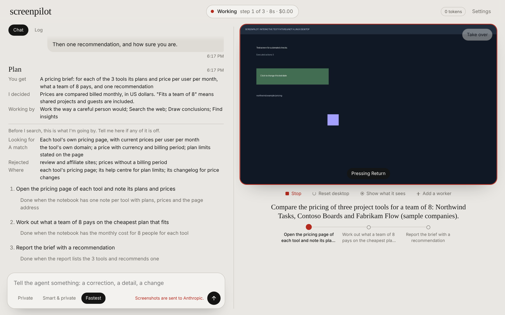

# Screenpilot

An AI agent with its own computer. Give it a long job: it plans, works on a Linux desktop through the screen, mouse and keyboard, and comes back with the result.

               



**[Watch the 70-second overview](docs/screenpilot.mp4)**

## What it does

- **Plans first.** It says what you will get, what it decided, and what proves each step is finished.
- **Works alone.** It stops only for logins, codes and approvals.
- **Talks while it works.** Ask a question, correct it, or rework the result in the chat.
- **Knows how.** Built-in playbooks for searching, finding people and companies, and drawing conclusions.
- **Runs on your machine.** In Docker, with local models, or with Claude or GPT.

## Start

Install [Docker Desktop](https://www.docker.com/products/docker-desktop/) and [Ollama](https://ollama.com/download), then:

```bash
./run.sh
```

Open **http://localhost:8080** and type a task.

## Modes

| Mode | Where the thinking happens |
|---|---|
| **Private** | On your Mac, with local models. Nothing leaves it. |
| **Smart & private** | A cloud model decides from a text description. Screenshots stay on your Mac. |
| **Fastest** | A cloud model (Claude or GPT) sees the screen. |

## More

The [guide](docs/GUIDE.md) covers setup options, approvals and accounts, Telegram, costs, know-how, troubleshooting, security and tests.

<sub>The screenshot and the video show a sample task with made-up companies, run in the built-in test mode with a scripted model. The dark pane is the test screen; in normal use it shows the live Linux desktop.</sub>
