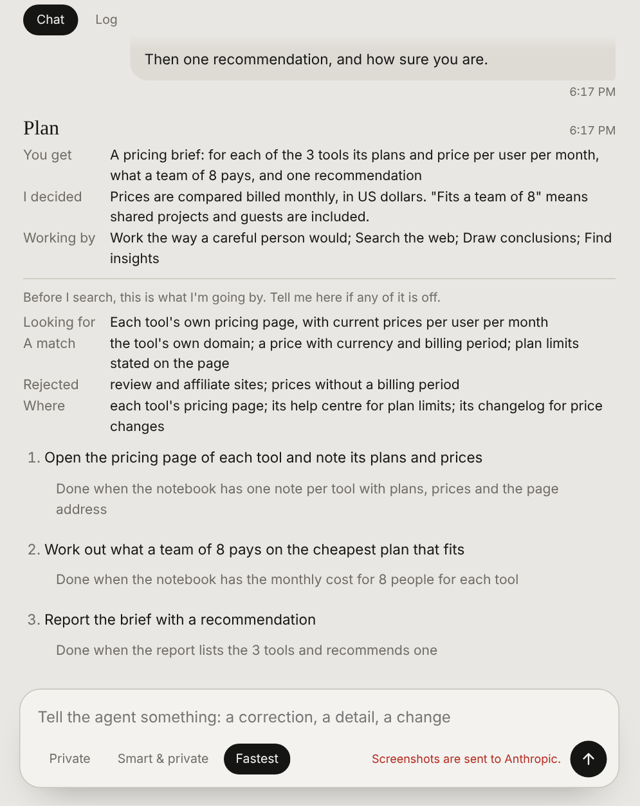
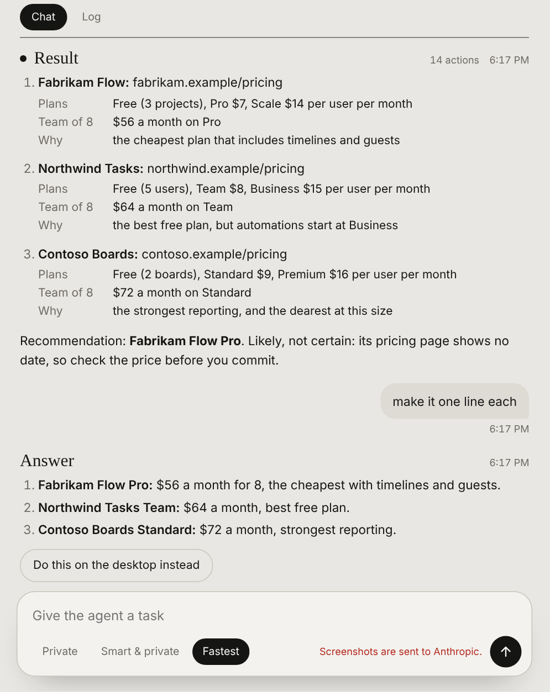
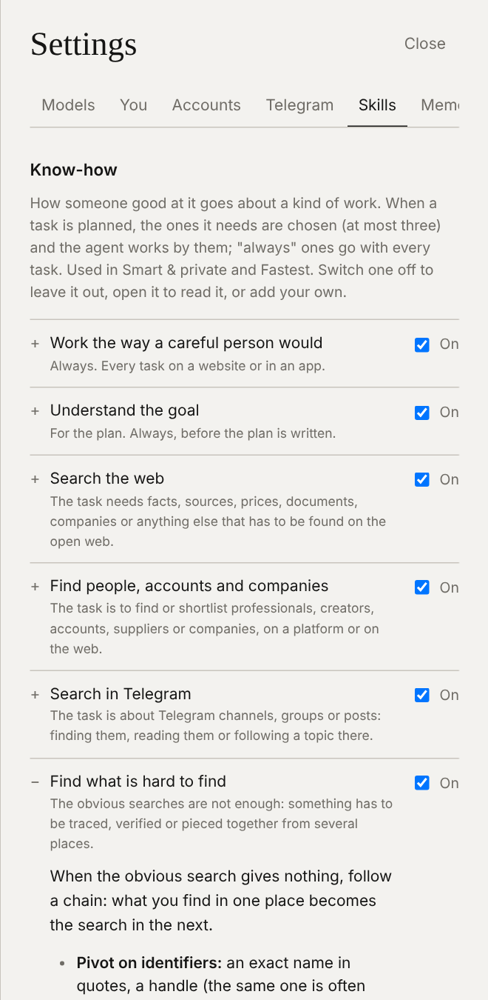

# Screenpilot guide

The [README](../README.md) is the short version. This is the rest, in the order you will need it.

| The plan | The result, reworked in the chat | Know-how |
|---|---|---|
|  |  |  |

<sub>Sample task with made-up companies, run in the built-in test mode with a scripted model.</sub>

## 1. Set up

Install [Docker Desktop](https://www.docker.com/products/docker-desktop/) and the [Ollama app](https://ollama.com/download) (0.12.7 or newer), then run `./run.sh` and open **http://localhost:8080**. The script tells you when Screenpilot is ready, or what is wrong. `./wait-ready.sh` asks again at any time.

The first run downloads the local models, by your Mac's memory:

| Memory | Installed |
|---|---|
| 24 GB or more | UI-TARS (about 5 GB), Holo (about 6 GB), Qwen3-VL 8B (6.2 GB) |
| Less | Qwen3-VL 4B (3.3 GB). Add the others with `UITARS=1 ./run.sh` or `HOLO=1 ./run.sh` |

- `UITARS=0` or `HOLO=0` skips a model. `OLLAMA_MODEL` in `.env` picks the Qwen model.
- With 16 GB, give Docker about 6 GB (Docker Desktop → Settings → Resources).
- `docker compose build --build-arg OFFICE=0` leaves LibreOffice out.
- For Claude or GPT, add a key in Settings → Models. To keep it across restarts, copy `.env.example` to `.env` and set `ANTHROPIC_API_KEY` or `OPENAI_API_KEY`.
- To update: `git pull && ./run.sh`.

## 2. Choose a mode

| Mode | Who decides | What leaves your Mac |
|---|---|---|
| **Private** | A local model: UI-TARS when installed, otherwise Qwen3-VL | Nothing |
| **Smart & private** | Claude or GPT, from a text description of the screen | The text description |
| **Fastest** | Claude or GPT, from the screenshots | The screenshots |

The line under the message box always says which of these applies.

- **Private** costs nothing and suits simple tasks. It has no plan checks and no know-how: the small local models have no room for them.
- **Smart & private** and **Fastest** are the modes for long jobs. Everything in section 4 applies to them.
- Settings → Models picks the cloud model. For GPT: Luna is the cheapest; Terra is built for working a computer and judges results better, at about ten times the price; Sol and Astra are stronger and dearer.

## 3. Give it a task

Type the task under the screen and press Enter. For a long job, write three things: the rules, the goal, and what the result should look like. The examples on the start screen show the form.

While it works:

- The pill at the top shows the state (Working, Your turn, Needs your approval) with the step, time and cost.
- The screen shows every click and keystroke. **Take over** hands you the mouse and keyboard.
- **Stop** ends the task. **Reset desktop** also closes its apps and reopens the browser.

The chat is not only for new tasks. In the cloud modes a short message is read first:

| You write | What happens |
|---|---|
| "make it shorter", "in Hebrew", "why not X?" | Answered in the chat from the last result and the notebook. The desktop is not touched. |
| "what have you found so far?" during a task | Answered in the chat. The task is not interrupted. |
| "skip anyone over 50k" during a task | Passed to the running task. |
| "two more like these" after a task | Continues the last task, starting from its notebook. |
| Anything else, or a long brief | A new task. |

A chat answer has a **Do this on the desktop instead** button, in case you meant work. When the agent has asked you something, your message is the answer. In Private mode a message is an instruction while a task runs and a new task otherwise.

## 4. How it works

**It plans first.** One request turns your task into a plan, shown in the chat:

- what you will get, concretely
- what it decided where you left something open
- for a search: who or what qualifies, what shows it on the screen, what rules a candidate out, and where to look
- the steps, each with what proves it is finished

You can correct any of it in the chat while it works.

**Every step is checked.** A step does not count because the agent says so. A separate check looks at the screen, the notebook and the last actions, and confirms it or says what is missing. The last step is checked against the promised result.

**It keeps a notebook.** The agent sees only its last few actions, so findings are written down as they are found. The notebook is what the chat answers from, and what you get if a task is stopped.

**It works alone.** When something fails it takes another route, then makes a new plan for what is left (at most twice), then leaves that part and goes on. It always ends with a report: what it found, and plainly what it could not do. If you would rather be asked, turn on "Ask me when it gets stuck" in Settings → Models.

**It is watched for loops.** Every few actions a progress check asks whether the work is getting closer to the goal. Repeated searches, clicks that change nothing and steps that only wait are caught and reported back to the agent.

**It works by know-how.** These are short playbooks, written the way someone good at the work would explain it. The planner picks up to three for a task; the plan says which.

| Know-how | Covers |
|---|---|
| Work the way a careful person would | Look first, one thing at a time, stop at a block or a login. Given to every task. |
| Understand the goal | The decision behind the request, quality over count. Given to the planner. |
| Search the web | Operators, primary sources, dates, when to change the kind of source |
| Find people, accounts and companies | Where leads come from, judging in two passes, proof from their own page |
| Search in Telegram | Reading public channels, finding and judging them, what needs your login |
| Find what is hard to find | Chains of identifiers, registries, archives |
| Draw conclusions | Seen versus inferred, the case against, how sure |
| Find insights | Making material comparable, reading across it |
| Carry out actions on sites | Forms, checking each step, never submitting twice |

Settings → Skills lists them: read one, switch it off, or add your own. The built-in ones are the files in `app/playbooks`. The lookups are for organisations, products and public, professional presence, and say not to locate or profile a private person.

**It remembers.** Facts it saved (Settings → Memory) and the recent conversation carry over to the next task. A short routine that went the same way start to finish is saved and replayed without a model the next time you ask for exactly that task.

## 5. What it needs you for

The agent asks only for what only you can do.

- **Approvals.** It asks before logging in, posting or sending, signing up, paying and deleting. Reading, searching, downloading and installing apps run without asking. Settings → You turns approvals off.
- **Your turn.** At a CAPTCHA, a missing password or an identity check it pauses. Take over, do the step, press **I'm done**. It does not solve CAPTCHAs.
- **Codes.** When a code arrives on your phone, type it in the box on the screen or send it to the Telegram bot. The model never sees it.
- **Saved logins** (Settings → Accounts). The agent asks for a login by name and Screenpilot types it. Passwords are never sent to a model, shown again or logged.
- **Its own mailbox** (Settings → Accounts). With an email account of its own it reads verification codes and links by itself. It cannot send or delete mail.
- **Your details** (Settings → You). It fills forms only with what you gave it and asks for anything missing.

## 6. Its computer

The desktop has Chromium, a text editor, a file manager, LibreOffice, an image viewer, an archive manager and a terminal. The agent can open any file in the right app, run commands and read their output, and install Debian packages.

The browser opens with the desktop. Close it when you do not need it: it stays closed until you, the agent or **Reset desktop** opens it again.

Its home folder, the browser's sign-ins and the installed apps are kept in the `screenpilot-data` volume and survive restarts and updates. `docker compose down -v` deletes them.

**Several workers.** **Add a worker** starts another agent with its own desktop, browser and conversation. Workers run at the same time and share memory, logins, settings and Telegram. Switch with `[` and `]` or the number keys. Each costs about 0.5 to 1 GB of memory; the limit is 6 (`SCREENPILOT_MAX_WORKERS`).

## 7. Cost

Private mode is free. In the cloud modes a long task is hundreds of requests, so three things keep the bill down:

- **Caching.** The instructions, the task and the know-how are the same at every step. They are sent first and marked, and the provider charges 5 to 10% for them after the first step. The log shows `cached=` on each request.
- **A cheap driver** (Settings → Models, off by default). With Terra, Sol or Astra chosen, Luna takes the routine steps. The model you chose still plans, checks every step, takes over when Luna is stuck, and takes every step that writes a note or the result.
- **No wasted steps.** A click that changed nothing is reported at once. Waiting for a page costs no request. A search already made is not made again.

The counter at the top right shows what the session has cost; click it for the breakdown. There is no limit unless you set one: Settings → Models has a limit per task and per day.

## 8. Telegram

1. In Telegram, open @BotFather and send `/newbot`.
2. Paste the token in Settings → Telegram.
3. Send your bot the pairing code shown there.

Then message it a task. Questions and results arrive with a screenshot and buttons. Commands: `/screen`, `/status`, `/stop`, `/memory`. Only your paired chat is listened to.

## 9. When something is wrong

- **The page does not load.** `./wait-ready.sh` says whether Screenpilot answers and its desktop runs. `docker compose logs --tail 80` shows why not.
- **What is it doing?** The **Log** tab next to Chat shows every model request, action and error, live, and what is still in progress. **Download log** saves it. The log never contains passwords, keys, typed text or prompts.
- **A cloud model cannot be reached.** The agent waits and tries again by itself.

### If UI-TARS misbehaves

- Clicks land in the wrong place: set `uitars_coords` to `pixels`.
- It acts as if it cannot see the screen: the download lacks the vision part. Get the GGUF and its mmproj from Hugging Face, run `ollama create ui-tars -f Modelfile` with a `FROM` line for each, and put that tag in Settings → Models.
- To use another build, set `UITARS_MODEL`.

## 10. Security

- The dashboard listens on `127.0.0.1:8080` only and has no login of its own. Keep it on your computer.
- Everything runs inside the container. No host folders and no Docker socket are mounted.
- The agent's desktop runs as its own user, `desk`, which cannot read Screenpilot's settings, saved passwords, mailbox password, Telegram token or API keys. Whatever a web page talks the agent into running, those are out of reach.

## 11. For developers

```bash
python3 cli.py "Write today's to-do list in a note and save it"   # a task from the terminal
python3 bench.py                  # five checkable tasks in each mode: passed, time, tokens, cost
python3 -m pip install -r requirements.txt && python3 -m unittest discover -s tests && node --check app/static/app.js
```

The tests use a synthetic screen and mocked models. They need no Docker, Ollama or keys, and they do not start the real desktop.

On Linux, or without the Ollama app, run Ollama as a container (CPU-only and slow on a Mac):

```bash
docker compose -f compose.yaml -f compose.ollama.yaml up --build
docker compose -f compose.yaml -f compose.ollama.yaml -f compose.nvidia.yaml up --build   # NVIDIA GPU
```
